# Maham Books

Free accounting and invoicing for businesses in Kuwait, in Arabic and English.
Built by AL Mail Group.

<p dir="rtl" lang="ar">برنامج مجاني للمحاسبة والفواتير، مصمم للشركات في الكويت، باللغتين العربية والإنجليزية.</p>

Maham Books runs in the browser and is hosted on Vercel. It works on one
device without an account, or with an account that keeps your companies in the
cloud (Supabase), on all your devices and with your team, and still works
offline.

**Open the app:** https://almail-books.vercel.app/

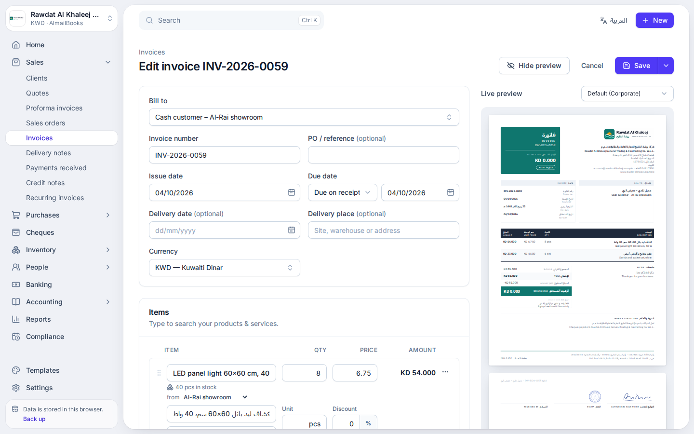

## Made for Kuwait

- **Arabic and English.** The whole app works in both languages and switches
  with one click; Arabic is right to left. Documents print in Arabic, in
  English, or in both side by side.
- **Kuwaiti dinars with fils.** Amounts have three decimals everywhere
  (KD 1,234.500 · 1,234.500 د.ك), and totals are written out in words in
  Arabic and English. Other currencies are kept with their exchange rates.
- **No VAT by default.** Kuwait has no VAT, so taxes are switched off. They can
  be switched on for a company if they are ever needed.
- **Kuwaiti details:** addresses by governorate, area, block, street, avenue,
  building, floor, unit and PACI number; Civil ID and IBAN checks for Kuwaiti
  banks; +965 phone numbers; Hijri dates on documents; Kuwait's public holidays
  and the Friday–Saturday weekend for leave.
- **A Kuwaiti chart of accounts** (IFRS) in Arabic and English, with accounts
  for post-dated cheques, retentions, PIFSS, end-of-service indemnity, the
  statutory reserve, KFAS, Zakat and NLST.

## Features

### Sales

- Quotes, proforma invoices, sales orders, delivery notes, invoices and credit
  notes, each converted into the next in one click. Recurring invoices.
- **Statements of account** for any customer or vendor and period, with a
  running balance, aging and the cheques not yet cleared: as a bilingual PDF,
  CSV, print or WhatsApp message, or for every customer with a balance at once.
- **Credit control:** a credit limit and credit hold per customer, with an
  exposure that counts uncleared cheques. The editors warn before a sale goes
  over the limit.
- **Retentions:** the 5% tax retention held until a tax clearance certificate
  is shown, and contract retentions. They wait in their own accounts until they
  are released.
- Payment links from MyFatoorah, Tap, UPayments, Hesabe, Ottu or your bank on
  invoices; sharing by WhatsApp or email.

### Payments and cheques

- KNET, WAMD, bank transfer, cash, cheque, card and payment links, with KNET
  and card fees.
- **Post-dated cheque register** for cheques received and issued: deposit,
  clear, return (with the bank's charge) and replace. Returned cheques are
  booked on the day they come back, so closed periods never change. Security
  (guarantee) cheques are kept on record.
- Receipt and payment vouchers in Arabic and English.
- A warning when a cash payment goes over the cash limit for the company's
  activity (for example vehicle, gold and real estate sales).

### Purchases and inventory

- Vendors, purchase orders, bills, vendor credits, payments made, and expenses
  with a photo of the receipt.
- Stock items, warehouses and transfers, weighted average cost, landed costs
  (customs duty, freight, clearing), cost of sales, stock count sheets and a
  low-stock report that leads to purchase orders.

### People and payroll

- Employees, Kuwaiti and expatriate, with their documents (Civil ID, passport,
  residency, work permit, contract, health insurance, driving licence) and
  reminders before they expire.
- A **compliance calendar** for the company's licences and filings: commercial
  licence and registration, PAM file, authorised signatories, MOF tax card and
  clearance certificate, KCCI membership, municipality and fire licences,
  PIFSS contributions, Zakat, KFAS, NLST, income tax and audited statements to
  MOCI.
- **Payroll:** allowances, overtime, deductions and staff loans, PIFSS
  contributions, leave and end-of-service indemnity under the Labour Law, and
  the salary transfer file for the bank (Wage Protection System).

### Accounting and banking

- Double-entry books kept automatically from every document, payment, cheque,
  stock movement and payroll run, plus manual journals and a lock date.
- Fixed assets with monthly depreciation and disposals.
- IFRS statements: profit and loss, balance sheet, cash flow and changes in
  equity; trial balance and general ledger with drill-down to every entry.
- Year-end close with the statutory reserve, KFAS, Zakat and NLST, and an
  auditor pack (a ZIP of the statements, ledgers and listings).
- Bank statements imported from online banking (CSV in any layout, including
  Arabic headings, or OFX), matched to the books and reconciled; transfers
  between your own accounts.
- Reports: receivables and payables aging, statements, customer exposure,
  retentions, sales, purchases, payments, stock and more, with CSV export.

### Everything else

- 10 PDF templates with your logo, brand colour, stamp and signature, and a
  live preview while you type.
- Several companies in one app.
- **Accounts and teams**: keep a company in the cloud, use it on every device
  and invite your accountant and staff by a link on WhatsApp or email, each
  with a role (owner, admin, accountant, staff, viewer). Staff and viewers never
  see payroll. Changes sync in the background and the app keeps working
  offline.
- **Email alerts**: owners and admins can get an email at 8:00 in the morning
  when papers expire, deadlines and cheques come due, bills are to pay or
  invoices become overdue, and a summary every Sunday (Settings → Email
  alerts; setup in [`docs/email-alerts.md`](docs/email-alerts.md)).
- Import contacts, items, opening balances and open invoices from CSV.
- Works offline and installs like an app on phones and computers.
- 20 themes, 10 light and 10 dark, chosen per device in **Settings →
  Appearance** or from the header, or following the device's light and dark
  setting. Documents always print on white paper.
- Backup and restore to a single file.

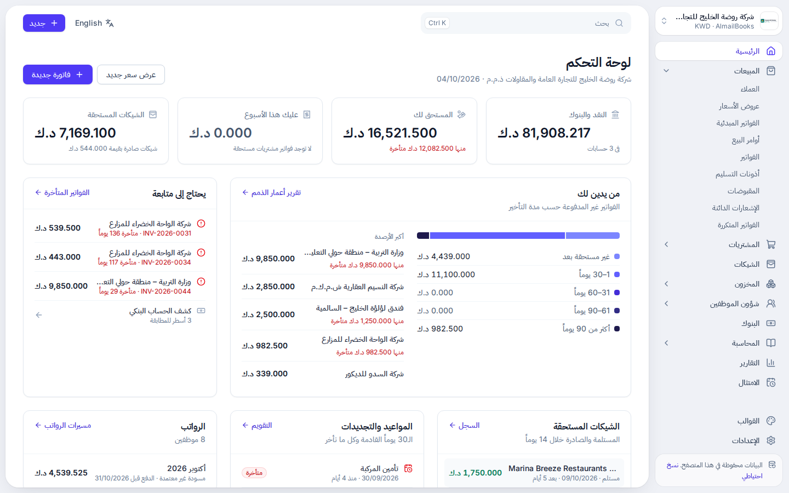

### Templates

Shown in Arabic and English side by side; each one also prints in Arabic or in
English only.

|                                  Modern                                  |                                  Minimal                                   |                                  Corporate                                   |                                  Elegant                                   |                                Bold                                |
| :----------------------------------------------------------------------: | :------------------------------------------------------------------------: | :--------------------------------------------------------------------------: | :------------------------------------------------------------------------: | :----------------------------------------------------------------: |
|  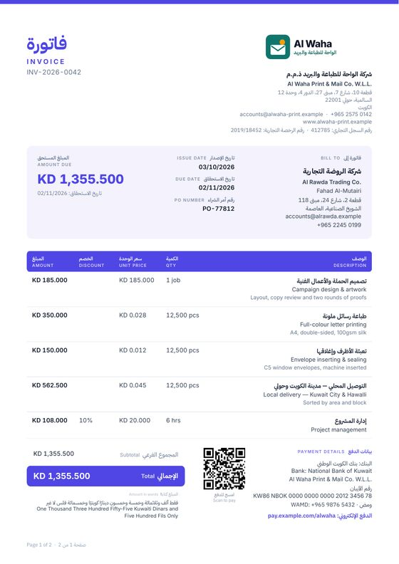  |  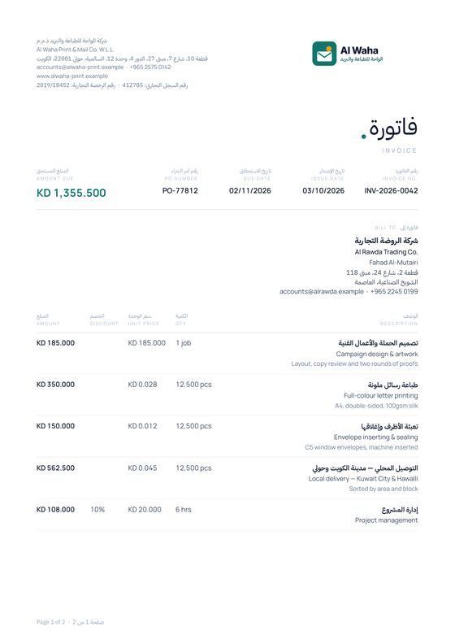  | 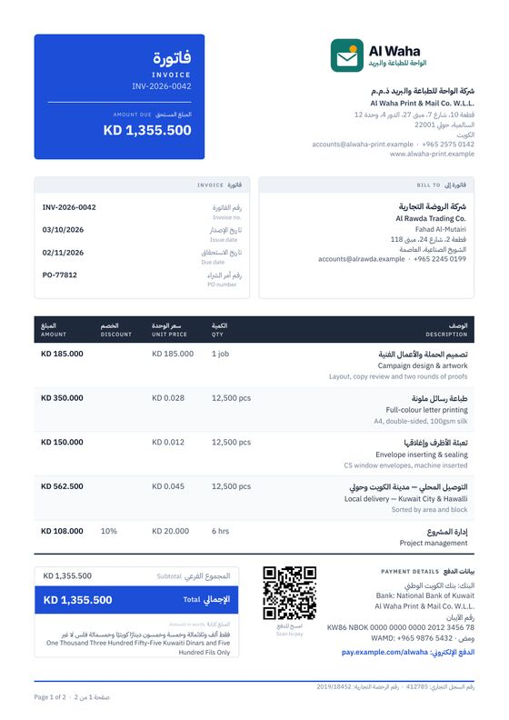 |  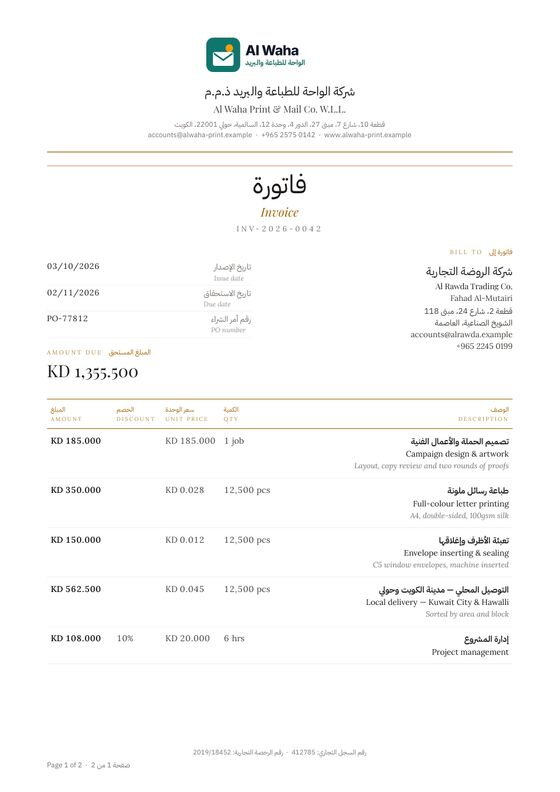  | 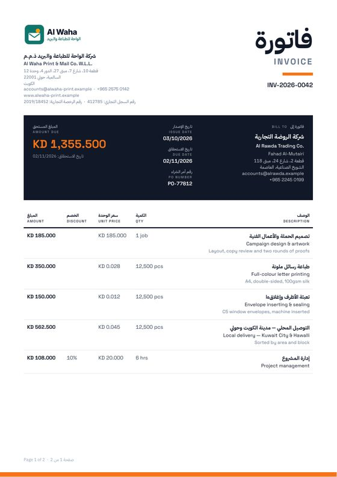 |
|                               **Classic**                                |                                **Creative**                                |                                 **Compact**                                  |                                **Gradient**                                |                              **Mono**                              |
| 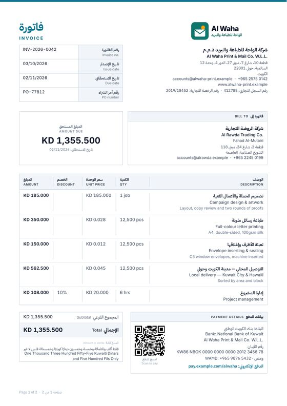 | 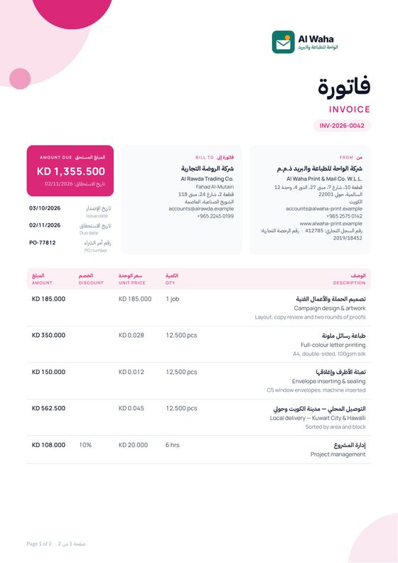 |   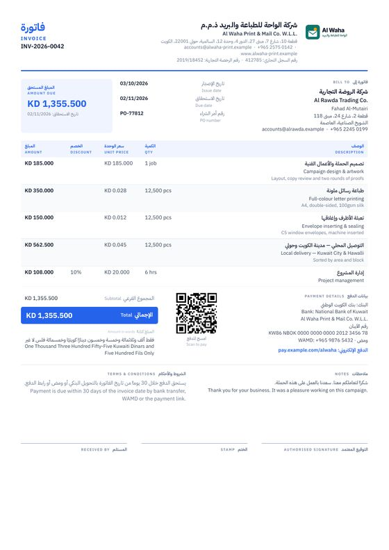   | 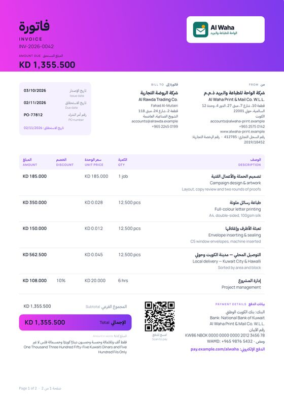 | 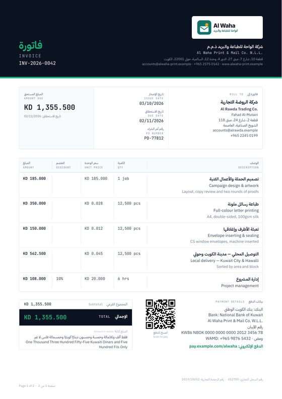 |

## Hosting on Vercel

Every push to `main` runs the checks in GitHub Actions (lint, formatting, type
check, unit tests, build and browser tests) and, when they pass, publishes the
new version to Vercel. Vercel's own Git deployments are switched off in
`vercel.json`, so only tested versions go live.

One-time setup:

1. In Vercel, import this repository as a project (framework preset **Vite**,
   build command `npm run build`, output directory `dist`).
2. Create an access token under **Account Settings → Tokens**, and copy the
   **Project ID** (project settings) and the **Team ID** (team settings).
3. In this repository on GitHub, add three secrets under **Settings → Secrets
   and variables → Actions**: `VERCEL_TOKEN`, `VERCEL_ORG_ID` (the team ID) and
   `VERCEL_PROJECT_ID`.

Until the secrets are set, the workflow still runs the checks and skips the
deployment with a notice. `vercel.json` also sets long-term caching for the
built assets and a few security headers.

The app uses relative paths, so it works on any domain. Browsers keep data per
site, so **back up before moving to a new address** and restore the backup
there.

## Where your data lives

- **Without an account** (Use on this device only), everything you enter is
  stored in your browser (IndexedDB) on the device you use. Nothing is sent to
  a server; Vercel only delivers the app itself. Other visitors of the site see
  an empty app with their own storage.
- **With an account**, the companies you choose to keep in the cloud are also
  stored in AL Mail Group's Supabase project, and synced to every device you
  sign in on and to the members of your team. The device keeps its own copy, so
  the app is just as fast and works offline; changes sync when the connection
  is back. Receipts and scans are kept in private file storage.
- The database decides who sees what (row-level security), by role: owner,
  admin, accountant, staff and viewer. Staff and viewers never receive salaries,
  payroll or employee documents. The app only uses Supabase's public
  (publishable) key.
- **Deletes are real**: what you delete is deleted in the cloud and on your
  team's devices, files included. A marker without any data tells other devices
  about it for up to 30 days. On Supabase's Pro plan, daily backups keep
  deleted data for up to 7 days; then it is gone.
- The demo company always stays on the device it was made on.
- **Each browser has its own copy.** Without an account, back up regularly
  from **Settings → Backup & data**; to move to another computer, choose
  **Restore a backup** on the welcome screen there. With an account, sign in on
  the other computer and download your companies.
- Clearing your browser's site data deletes this device's copy (and, for
  companies on this device only, the records). The app asks the browser to
  protect its storage, and installing the app makes this more reliable.

Setting up the cloud is described in
[`docs/supabase-setup.md`](docs/supabase-setup.md), email alerts in
[`docs/email-alerts.md`](docs/email-alerts.md); the server, its rules and the
security checklist in [`supabase/README.md`](supabase/README.md).

## Offline and installing

After the first visit the app works without an internet connection, including
PDF creation. To install it, use the install icon in the address bar (Chrome,
Edge) or **Share → Add to Home Screen** (Safari on iPhone and iPad). When a new
version is published, the app shows a **Reload** button instead of reloading
on its own, so unsaved work is never lost.

## Development

Requires Node.js 22.12 or newer (see `.nvmrc`).

```bash
npm install
npm run dev         # development server at http://localhost:5173
npm test            # unit tests (Vitest)
npm run test:e2e    # production build + browser tests (Playwright)
npm run lint        # ESLint
npm run typecheck   # TypeScript
npm run format      # Prettier (CI runs `npm run format:check`)
npm run build       # production build in dist/
npm run preview     # serve dist/ locally
```

The first time you run the browser tests, install Chromium with
`npx playwright install chromium`.

### Project layout

```
src/
  app/          app shell, routing, active company, offline support
  pages/        screens: dashboard, sales, purchases, cheques, people, payroll, reports, settings
  features/     editors, dialogs and panels used by the screens
  components/   UI building blocks, PDF preview, charts
  db/           IndexedDB schema (Dexie), the records of every module, demo data
  lib/          money, Kuwait data, ledger and financial statements, payroll, inventory
  cloud/        accounts, sync engine (outbox, push and pull), roles, invitations
  alerts/       email alerts: what needs attention, the email, the Supabase function
  i18n/         translation functions and the Arabic dictionaries (ar/*.ts)
  pdf/          PDF templates (react-pdf), fonts, document wording, statements, PDF worker
e2e/            browser tests
supabase/       the cloud database (SQL migrations), its security notes, the function's settings
docs/           Arabic glossary, cloud and email alerts setup guides, screenshots
scripts/        regenerate fonts, template thumbnails and app icons
```

### Arabic translations

- Every text in the interface is written in English in the code
  (`t('Save')`, `tp(count, '{count} cheque', '{count} cheques')`), and its
  Arabic is in `src/i18n/ar/*.ts`.
- `docs/arabic-glossary.md` lists the accounting and business terms, so the
  same word is always translated the same way.
- `npm test` fails when a text has no Arabic, when a `{placeholder}` differs or
  when two files translate the same text differently.

### Changing templates and assets

- Each template is a file in `src/pdf/templates/`, built from the shared
  pieces in `shared.tsx`. Names and descriptions are in
  `src/pdf/template-meta.ts`.
- Render sample PDFs and PNGs:
  `npx tsx --tsconfig tsconfig.scripts.json scripts/render-templates.tsx out/ [template]`.
- Regenerate the gallery thumbnails with `scripts/make-thumbnails.sh` (needs
  poppler and ImageMagick).
- Regenerate the fonts with `scripts/subset-fonts.sh` (needs `pip install fonttools`).
- Regenerate the app icons from `public/favicon.svg` with `node scripts/make-icons.mjs`.

## Credits

The feature set was inspired by [Invoice Ninja](https://github.com/invoiceninja/invoiceninja),
and the accounting design by the documentation of [Odoo](https://www.odoo.com).
No code was copied from either. The fonts, including IBM Plex Sans Arabic, are
under the SIL Open Font License (see `src/pdf/fonts/LICENSE.md`).
